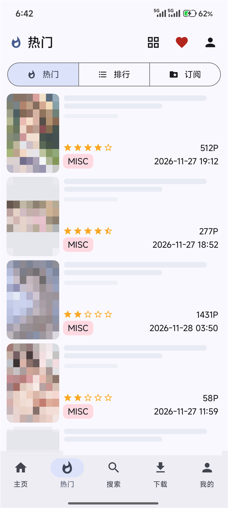
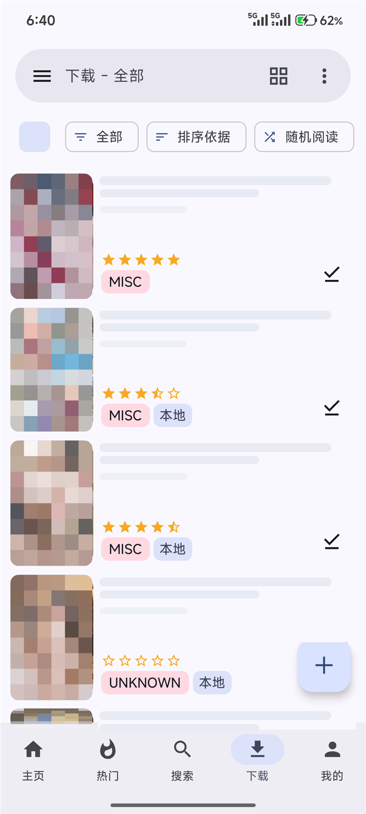
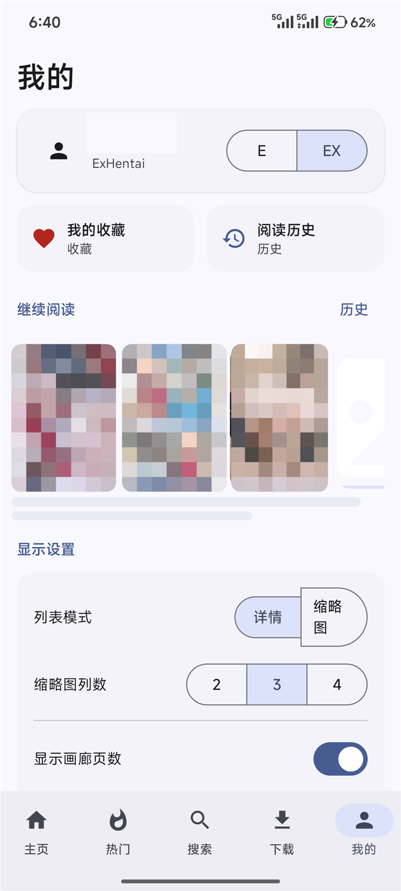

Derived from FooIbar and refined via vibe coding, issues welcome: https://github.com/ikura23/EhViewer/issues

  <a href="/README.md">
  简体中文
  </a>
   | 
  <strong>English</strong>
   | 
  <a href="/docs/README/zh-tw.md">
  正體中文
  </a>
   | 
  <a href="/docs/README/ja.md">
  日本語
  </a>

<h1 align="center">
  
   EhViewer 
</h1>

  
  
  
  

  <h3>
    <a href="#description">
    Description
    </a>
     | 
    <a href="#download">
    Download
    </a>
     | 
    <a href="#screenshot">
    Screenshot
    </a>
     | 
    <a href="#thanks">
    Thanks
    </a>
     | 
    <a href="#license">
    License
    </a>
  </h3>

# Description

A modern Android client refined from FooIbar/EhViewer with Material Design 3 Dynamic Color.

- **Experimental New UI**: 5-tab bottom navigation, swipeable Hot/Toplist/Subscription pager, visual tag recommendations, and global Non-H mode.
- **Animated WebP & Enhancement**: Rust + AHB zero-copy WebP playback with speed control, eye-care filter presets, and real-time GPU image enhancement (Android 13+).
- **Local Library Management**: Local gallery scanning, duplicate version detection/merge, and quick random read in downloads.

# Download

- **Package ID**: `com.ys.ehviewer` (independent signing, coexists with upstream builds)
- **Minimum OS**: Android 8.0+ (GPU enhancement requires Android 13+)

| ABI | Notes |
|-----|-------|
| `arm64-v8a` | Recommended for most modern phones |
| `armeabi-v7a` / `x86_64` / `universal` | Legacy devices / emulators / universal APK |

# Screenshot

  
  
  
  

# Thanks

Here is the libraries

- [Arrow](https://arrow-kt.io/)
- [AOSP & AndroidX](https://source.android.com/)
- [Kotlin & KotlinX](https://kotlinlang.org/)
- [Material Icons](https://github.com/google/material-design-icons)
- [Ktor](https://ktor.io/)
- [Coil](https://coil-kt.github.io/coil/)
- [Compose Destinations](https://composedestinations.rafaelcosta.xyz/)
- [libarchive](https://www.libarchive.org/)

# License

    Copyright 2014-2019 Hippo Seven
    Copyright 2020-2022 NekoInverter
    Copyright 2022-2023 Tarsin Norbin
    Copyright 2023-2024 Foolbar

    EhViewer is free software: you can redistribute it and/or modify it under the terms of the GNU General Public License as published by the Free Software Foundation, either version 3 of the License, or (at your option) any later version.

    EhViewer is distributed in the hope that it will be useful, but WITHOUT ANY WARRANTY; without even the implied warranty of MERCHANTABILITY or FITNESS FOR A PARTICULAR PURPOSE. See the GNU General Public License for more details.

    You should have received a copy of the GNU General Public License along with EhViewer. If not, see <https://www.gnu.org/licenses/>.
