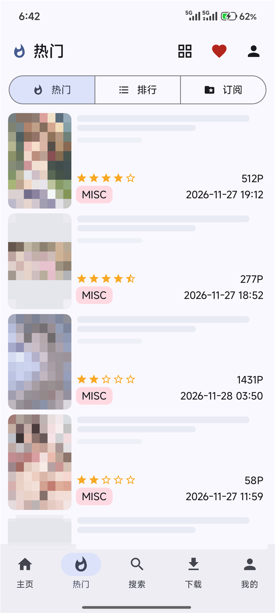
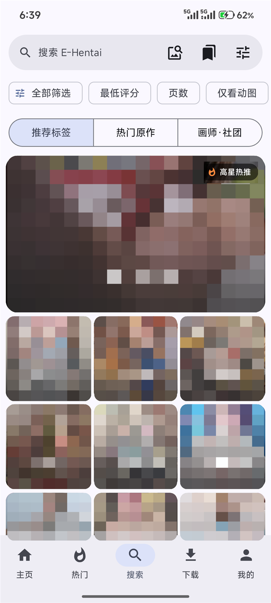
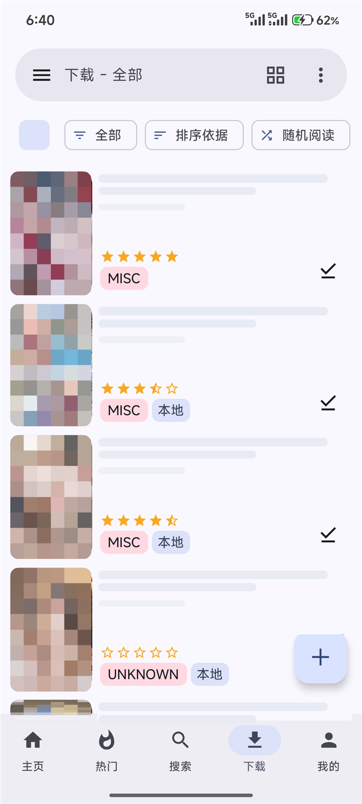
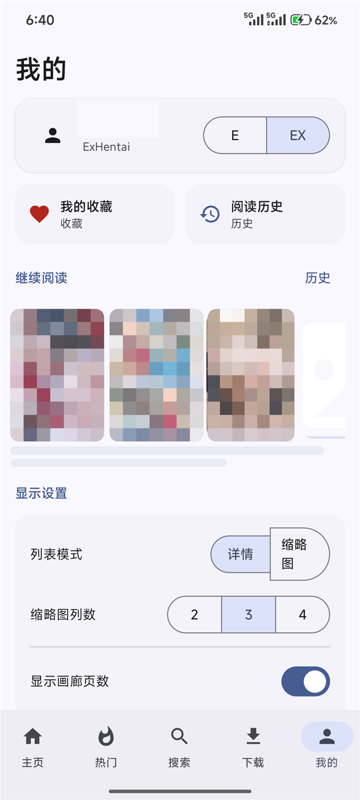

源自FooIbar，用vibe coding最適化・公開（Issues歓迎: https://github.com/FooIbar/EhViewer ）

  <a href="/README.md">
  简体中文
  </a>
   | 
  <a href="/docs/README/en.md">
  English
  </a>
   | 
  <a href="/docs/README/zh-tw.md">
  正體中文
  </a>
   | 
  <strong>日本語</strong>

<h1 align="center">
  
   EhViewer 
</h1>

  
  
  
  

  <h3>
    <a href="#説明">
    説明
    </a>
     | 
    <a href="#ダウンロード">
    ダウンロード
    </a>
     | 
    <a href="#スクリーンショット">
    スクリーンショット
    </a>
     | 
    <a href="#感謝">
    感謝
    </a>
     | 
    <a href="#ライセンス">
    ライセンス
    </a>
  </h3>

# 説明

FooIbar/EhViewer をベースに最適化した Material Design 3（ダイナミックカラー）対応のモダン Android クライアントです。

- **実験的新版 UI**：5 タブ下部ナビゲーション、人気／ランキング／購読のスワイプ切替、おすすめタグウォール、グローバル Non-H モード。
- **WebP アニメーション＆画質強化**：Rust + AHB ゼロコピー倍速再生、アイケアフィルター、GPU リアルタイム画質強化（Android 13+）。
- **ローカルライブラリ管理**：ローカルスキャン、新旧重複ギャラリーの自動検出・統合、ランダム閲覧。

# ダウンロード

- **パッケージ名**：`com.ys.ehviewer`（独自署名のためオリジナル版と共存可能）
- **対応 OS**：Android 8.0+（GPU 画質強化は Android 13+）

| ABI | 備考 |
|-----|------|
| `arm64-v8a` | 推奨（多くの最新端末） |
| `armeabi-v7a` / `x86_64` / `universal` | 旧端末 / エミュレータ / ユニバーサル版 |

# スクリーンショット

  
  
  
  

# 感謝

使用しているライブラリ

- [Arrow](https://arrow-kt.io/)
- [AOSP & AndroidX](https://source.android.com/)
- [Kotlin & KotlinX](https://kotlinlang.org/)
- [Material Icons](https://github.com/google/material-design-icons)
- [Ktor](https://ktor.io/)
- [Coil](https://coil-kt.github.io/coil/)
- [Compose Destinations](https://composedestinations.rafaelcosta.xyz/)
- [libarchive](https://www.libarchive.org/)

# ライセンス

    Copyright 2014-2019 Hippo Seven
    Copyright 2020-2022 NekoInverter
    Copyright 2022-2023 Tarsin Norbin
    Copyright 2023-2024 Foolbar

    EhViewer is free software: you can redistribute it and/or modify it under the terms of the GNU General Public License as published by the Free Software Foundation, either version 3 of the License, or (at your option) any later version.

    EhViewer is distributed in the hope that it will be useful, but WITHOUT ANY WARRANTY; without even the implied warranty of MERCHANTABILITY or FITNESS FOR A PARTICULAR PURPOSE. See the GNU General Public License for more details.

    You should have received a copy of the GNU General Public License along with EhViewer. If not, see <https://www.gnu.org/licenses/>.
