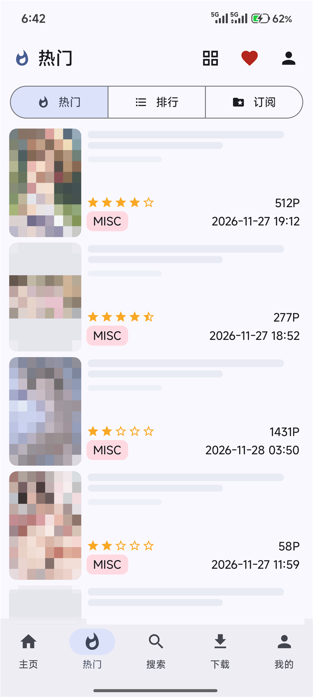
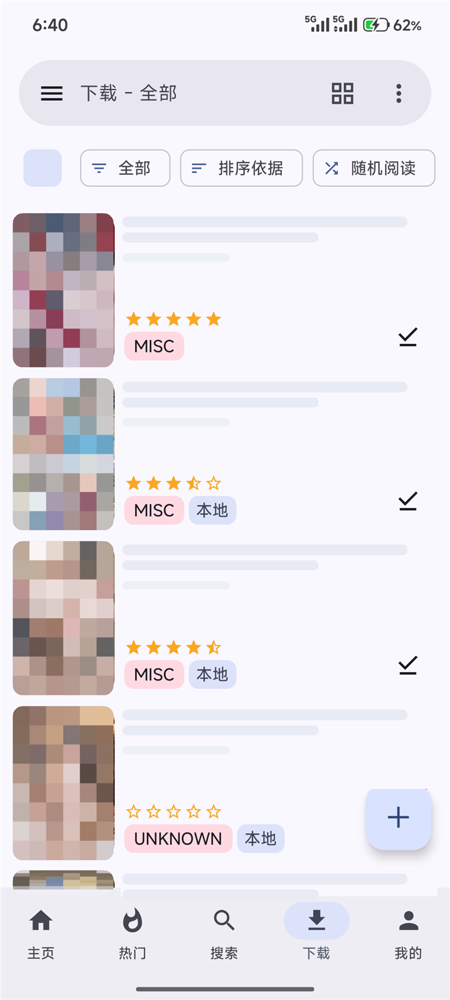
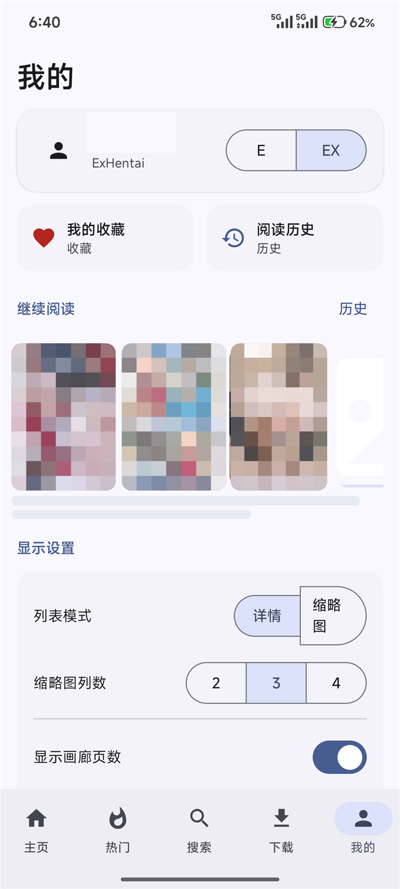

源自FooIbar，用vibe coding优化并发布，欢迎提issues https://github.com/ikura23/EhViewer/issues

  <strong>简体中文</strong>
   | 
  <a href="/docs/README/en.md">
  English
  </a>
   | 
  <a href="/docs/README/zh-tw.md">
  正體中文
  </a>
   | 
  <a href="/docs/README/ja.md">
  日本語
  </a>

<h1 align="center">
  
   EhViewer 
</h1>

  
  
  
  

  <h3>
    <a href="#描述">
    描述
    </a>
     | 
    <a href="#下载">
    下载
    </a>
     | 
    <a href="#截图">
    截图
    </a>
     | 
    <a href="#感谢">
    感谢
    </a>
     | 
    <a href="#许可证">
    许可证
    </a>
  </h3>

# 描述

基于 FooIbar/EhViewer 优化的现代 Android 客户端，适配 Material Design 3 动态取色。

- **实验性新版界面**：5 Tab 底部导航、热门/排行/订阅滑动切换、高星标签推荐墙与全局 Non-H 模式。
- **动图与画质增强**：Rust + AHB 零拷贝 WebP 动图倍速播放、护眼滤镜预设与 GPU 实时画质增强（Android 13+）。
- **本地书库管理**：本地画廊扫描、同名新旧版本自动检测合并与下载页随机阅读。

# 下载

- **包名**：`com.ys.ehviewer`（独立签名，可与原版共存）
- **最低系统**：Android 8.0+（GPU 画质增强需 Android 13+）

| 架构 | 说明 |
|------|------|
| `arm64-v8a` | 推荐，绝大多数现代手机 |
| `armeabi-v7a` / `x86_64` / `universal` | 旧设备 / 模拟器 / 通用包 |

# 截图

  
  
  
  

# 感谢

本项目受到了诸多开源项目的帮助

- [Arrow](https://arrow-kt.io/)
- [AOSP & AndroidX](https://source.android.com/)
- [Kotlin & KotlinX](https://kotlinlang.org/)
- [Material Icons](https://github.com/google/material-design-icons)
- [Ktor](https://ktor.io/)
- [Coil](https://coil-kt.github.io/coil/)
- [Compose Destinations](https://composedestinations.rafaelcosta.xyz/)
- [libarchive](https://www.libarchive.org/)

# 许可证

    Copyright 2014-2019 Hippo Seven
    Copyright 2020-2022 NekoInverter
    Copyright 2022-2023 Tarsin Norbin
    Copyright 2023-2024 Foolbar

    EhViewer is free software: you can redistribute it and/or modify it under the terms of the GNU General Public License as published by the Free Software Foundation, either version 3 of the License, or (at your option) any later version.

    EhViewer is distributed in the hope that it will be useful, but WITHOUT ANY WARRANTY; without even the implied warranty of MERCHANTABILITY or FITNESS FOR A PARTICULAR PURPOSE. See the GNU General Public License for more details.

    You should have received a copy of the GNU General Public License along with EhViewer. If not, see <https://www.gnu.org/licenses/>.
