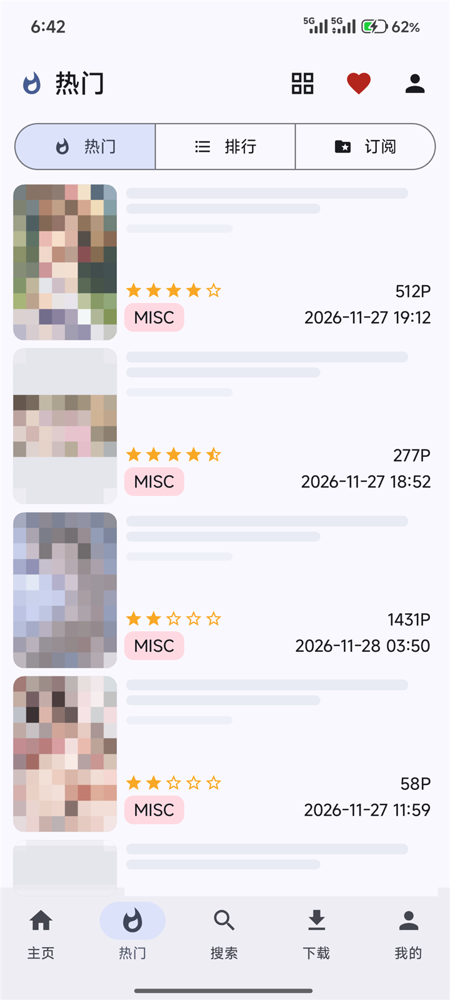
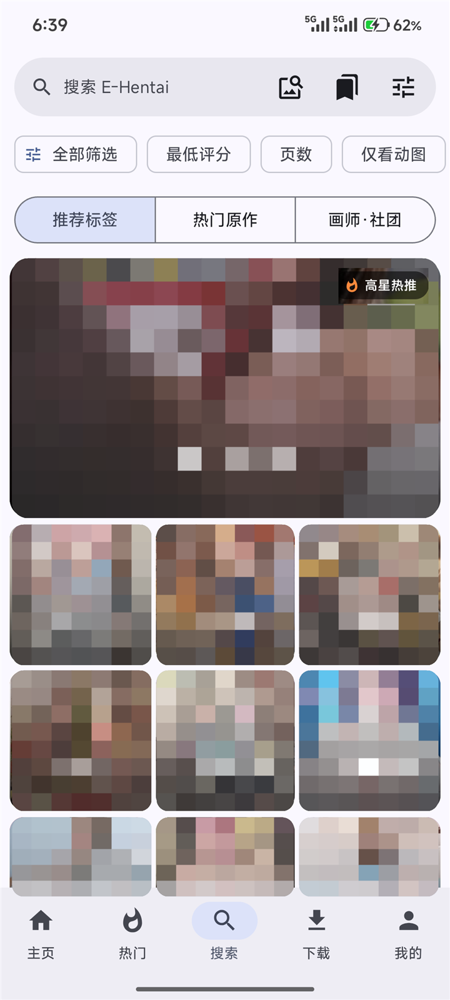
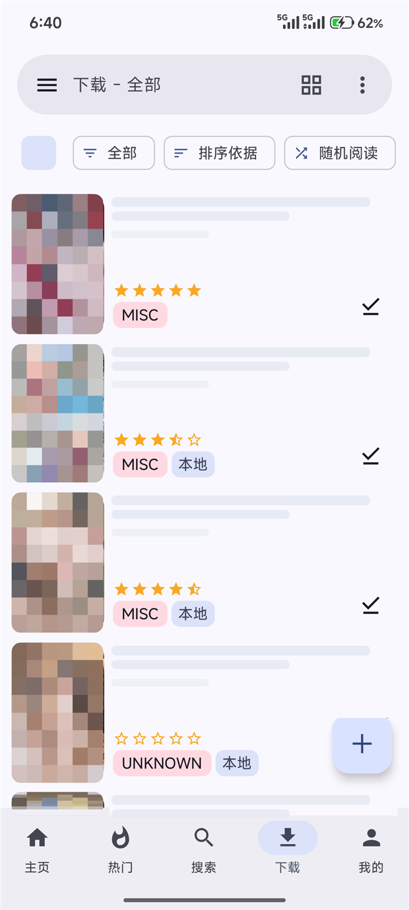
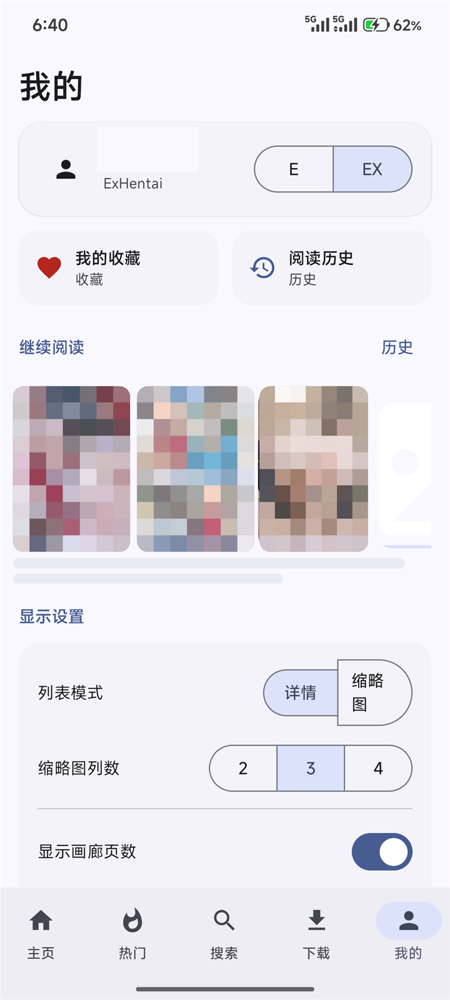

源自FooIbar，用vibe coding優化並發布，歡迎提issues https://github.com/FooIbar/EhViewer

  <a href="/README.md">
  简体中文
  </a>
   | 
  <a href="/docs/README/en.md">
  English
  </a>
   | 
  <strong>正體中文</strong>
   | 
  <a href="/docs/README/ja.md">
  日本語
  </a>

<h1 align="center">
  
   EhViewer 
</h1>

  
  
  
  

  <h3>
    <a href="#說明">
    說明
    </a>
     | 
    <a href="#下載">
    下載
    </a>
     | 
    <a href="#截圖">
    截圖
    </a>
     | 
    <a href="#感謝">
    感謝
    </a>
     | 
    <a href="#許可證書">
    許可證書
    </a>
  </h3>

# 說明

基於 FooIbar/EhViewer 優化的現代 Android 客戶端，適配 Material Design 3 動態取色。

- **實驗性新版介面**：5 Tab 底部導覽、熱門/排行/訂閱滑動切換、高星標籤推薦牆與全域 Non-H 模式。
- **動圖與畫質增強**：Rust + AHB 零拷貝 WebP 動圖倍速播放、護眼濾鏡預設與 GPU 即時畫質增強（Android 13+）。
- **本地書庫管理**：本地畫廊掃描、同名新舊版本自動偵測合併與下載頁隨機閱讀。

# 下載

- **套件名稱**：`com.ys.ehviewer`（獨立簽名，可與原版共存）
- **最低系統**：Android 8.0+（GPU 畫質增強需 Android 13+）

| 架構 | 說明 |
|------|------|
| `arm64-v8a` | 推薦，絕大多數現代手機 |
| `armeabi-v7a` / `x86_64` / `universal` | 舊裝置 / 模擬器 / 通用套件 |

# 截圖

  
  
  
  

# 感謝

本項目受到了諸多開源項目的幫助

- [Arrow](https://arrow-kt.io/)
- [AOSP & AndroidX](https://source.android.com/)
- [Kotlin & KotlinX](https://kotlinlang.org/)
- [Material Icons](https://github.com/google/material-design-icons)
- [Ktor](https://ktor.io/)
- [Coil](https://coil-kt.github.io/coil/)
- [Compose Destinations](https://composedestinations.rafaelcosta.xyz/)
- [libarchive](https://www.libarchive.org/)

# 許可證書

    Copyright 2014-2019 Hippo Seven
    Copyright 2020-2022 NekoInverter
    Copyright 2022-2023 Tarsin Norbin
    Copyright 2023-2024 Foolbar

    EhViewer is free software: you can redistribute it and/or modify it under the terms of the GNU General Public License as published by the Free Software Foundation, either version 3 of the License, or (at your option) any later version.

    EhViewer is distributed in the hope that it will be useful, but WITHOUT ANY WARRANTY; without even the implied warranty of MERCHANTABILITY or FITNESS FOR A PARTICULAR PURPOSE. See the GNU General Public License for more details.

    You should have received a copy of the GNU General Public License along with EhViewer. If not, see <https://www.gnu.org/licenses/>.
